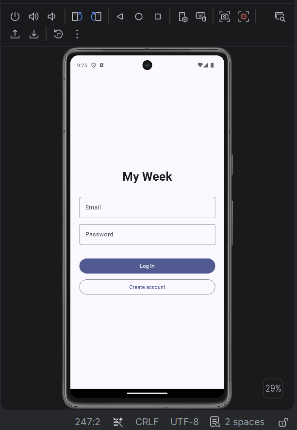
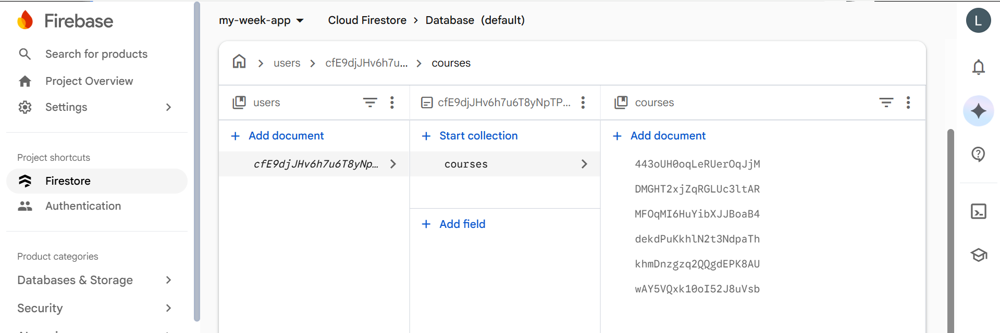
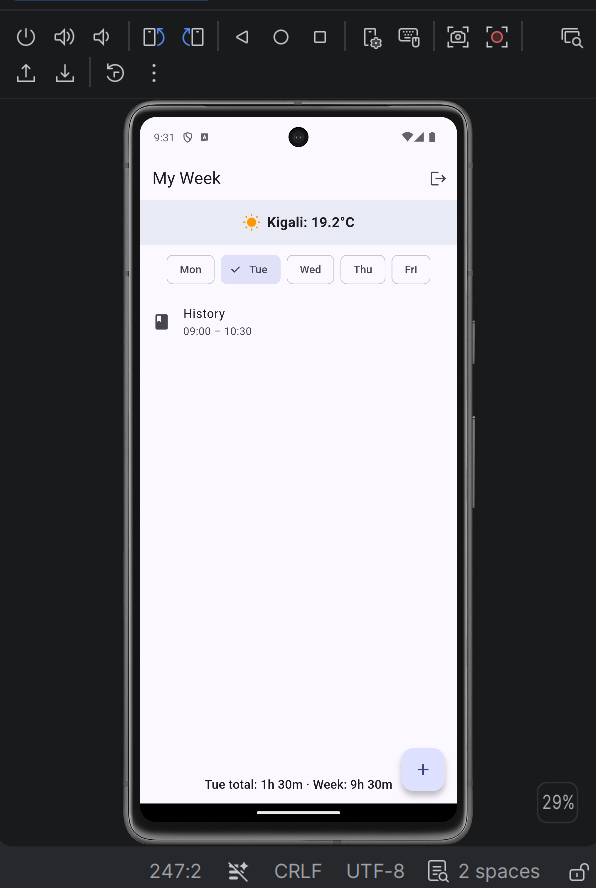
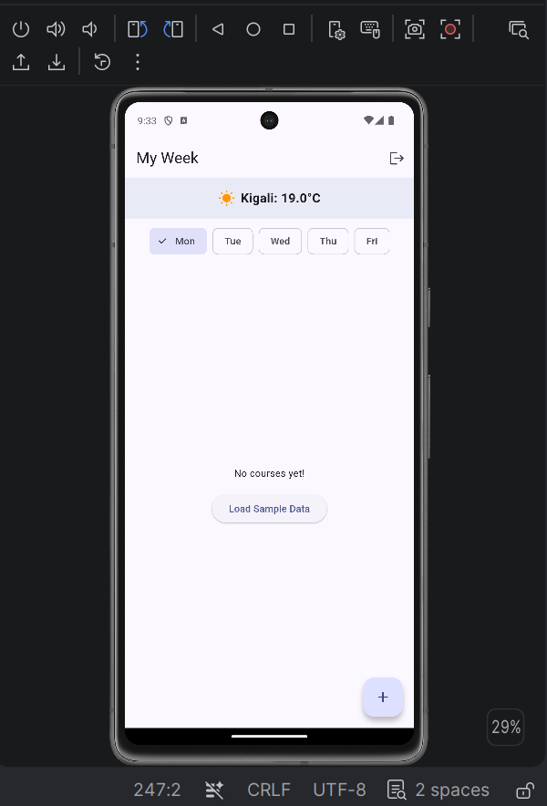

# My Week

My Week is a Flutter app that helps you organize your class schedule. It signs users in with Firebase Authentication, and each user's data is saved in Cloud Firestore under their own id, so two accounts never see each other's data, and every change appears live.

## Screenshots

## Features
- Browse the week by day (Mon–Fri) using day chips.
- Add, edit, and delete courses.
- Automatic clash detection: clashing courses are highlighted in red and name the conflicting course.
- Live calculation of per-day totals and the overall week total.
- User accounts with Firebase Authentication.
- Cloud data storage with Cloud Firestore (syncs live).
- Shows live weather data from Open-Meteo API.