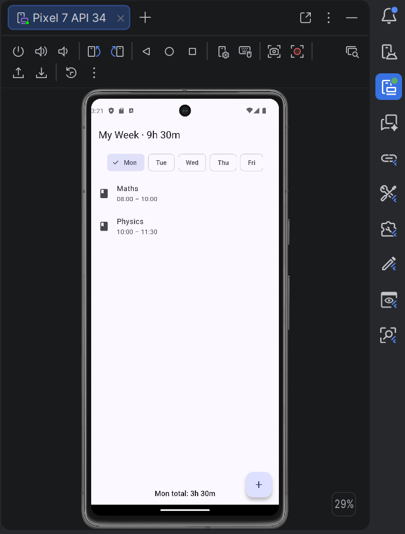
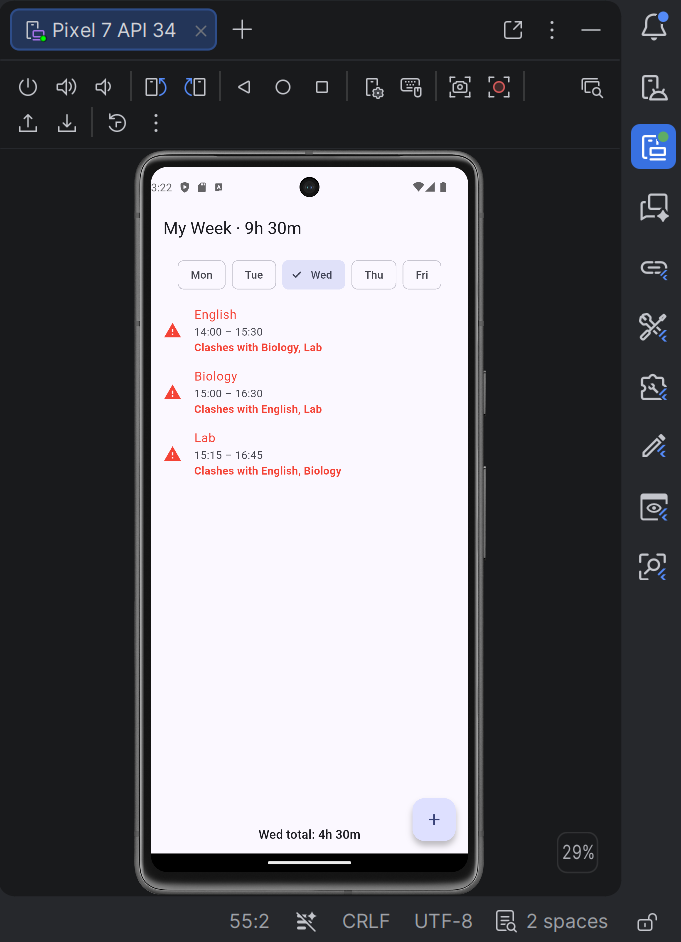
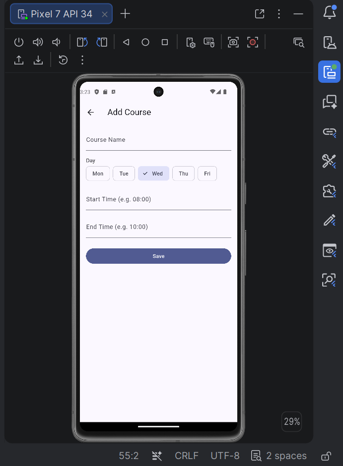
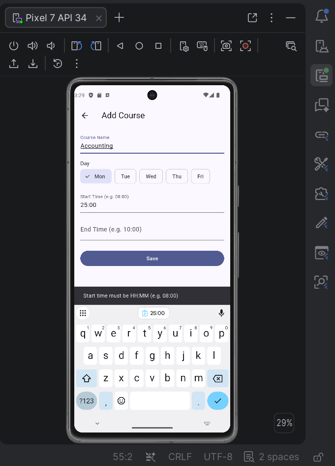

# My Week App

## Project Choice
I chose: **My Week**

## Features
- Browse the week by day (Mon–Fri) using day chips.
- Add, edit, and delete courses.
- Automatic clash detection: clashing courses are highlighted in red and name the conflicting course.
- Live calculation of per-day totals and the overall week total.
- Input validation for times (must be HH:MM, end time must be after start time).
- Empty states for days with no classes.
- Delete confirmation ("Are you sure?") dialog.

## Screenshots

### 1. Monday View
*Showing the correct 3h 30m total with no red clashes (touching times).*

### 2. Wednesday Clashes
*Showing the red warnings and the clash messages.*

### 3. Add Course
*The form to add a new course.*

### 4. Edit Course
*Editing an existing course.*

### 5. Validation Error
*The app refusing invalid input with a warning message.*

## Think Answers

**1. Write your clash condition in plain words. Why `<` and not `<=`?**
Two courses clash if each starts strictly before the other ends (`A.start < B.end && B.start < A.end`). We use `<` instead of `<=` because if one course ends at 11:00 and the next starts at 11:00, they do *not* overlap. The student has time to move to the next class. Using `<=` would falsely flag back-to-back classes as a clash.

**2. Why is it easier to store times as minutes than as text like 08:30?**
Text is for humans; minutes are for math. Storing time as minutes from midnight (e.g., 510 for 08:30) allows us to easily compare, subtract, and sort. If we stored strings, "8:30" would be compared alphabetically and could cause logic errors. Converting to an integer once makes all other calculations instant and bug-free.

## How to Run
1. Clone this repository.
2. Run `flutter pub get`.
3. Run `flutter run`.