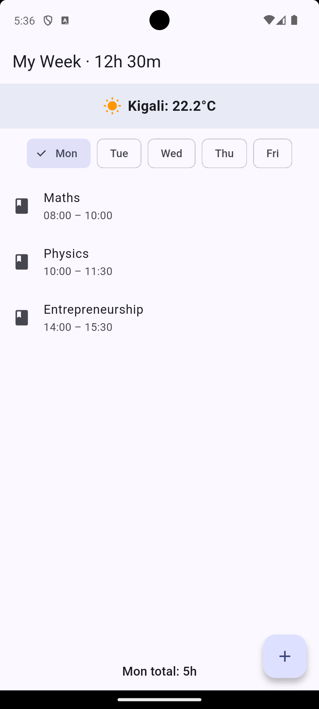
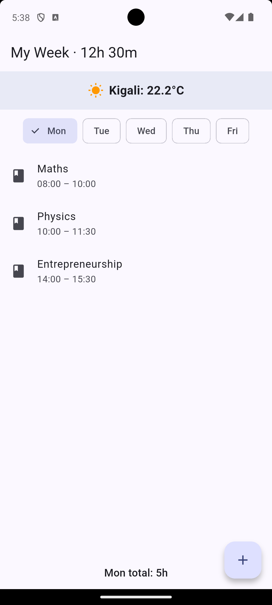
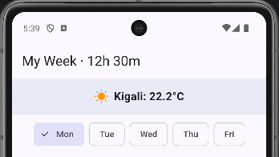
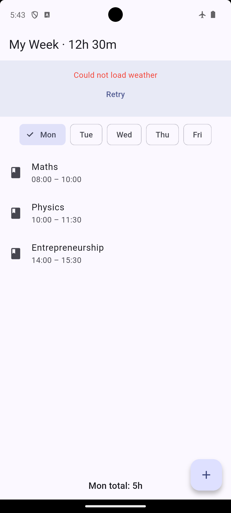

# My Week App

My Week is a Flutter app that helps you organize your class schedule. My data is now saved on the phone with `shared_preferences`, so nothing is lost when the app closes, and it shows the live Kigali temperature from the Open-Meteo API.

## Screenshots

## Features
- Browse the week by day (Mon–Fri) using day chips.
- Add, edit, and delete courses.
- Automatic clash detection: clashing courses are highlighted in red and name the conflicting course.
- Live calculation of per-day totals and the overall week total.
- Data is saved locally using `shared_preferences`.
- Shows live weather data from Open-Meteo API.

## Think Answers

**1. Write your clash condition in plain words. Why `<` and not `<=`?**
Two courses clash if each starts strictly before the other ends (`A.start < B.end && B.start < A.end`). We use `<` instead of `<=` because if one course ends at 11:00 and the next starts at 11:00, they do *not* overlap. The student has time to move to the next class. Using `<=` would falsely flag back-to-back classes as a clash.

**2. Why is it easier to store times as minutes than as text like 08:30?**
Text is for humans; minutes are for math. Storing time as minutes from midnight (e.g., 510 for 08:30) allows us to easily compare, subtract, and sort. If we stored strings, "8:30" would be compared alphabetically and could cause logic errors. Converting to an integer once makes all other calculations instant and bug-free.

## How to Run
1. Clone this repository.
2. Run `flutter pub get`.
3. Run `flutter run`.